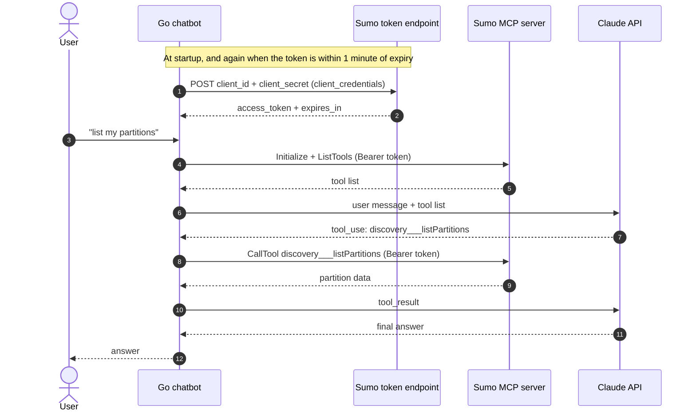

# Sumo Logic MCP Chatbot

A Go chatbot that answers questions about Sumo Logic (partitions, field extraction rules, dashboards, alerts, logs) by calling the Sumo Logic MCP server. Claude decides which tool to call, the Go program runs it on Sumo, and Claude writes the answer.

## Architecture



- **Client ID and secret:** used only at the token step.
- **Bearer token:** sent with every MCP request. It expires after 30 minutes, and the chatbot refreshes it and reconnects before it does.
- **Anthropic key:** sent with every Claude request.
- **Tool loop:** Claude can request several tools in turn. The loop stops after 10 rounds.

## Code layout

All code is in `main.go`:

| Function | Purpose |
|---|---|
| `fetchToken` | Gets a Sumo access token with the Client Credentials flow |
| `connect` | Creates the MCP client with the bearer token and initializes it |
| `toolDefs` | Converts Sumo's tools into Claude's format, skipping `x_amz_bedrock_agentcore_search` |
| `callClaude` | Sends the conversation and tools to the Claude API |
| `runTool` | Calls a Sumo tool with a timeout and truncates long output |
| `ask` | Runs one question through Claude, executing tool calls until Claude answers |
| `main` | Reads config, connects, runs the chat loop, and refreshes the token |

## Configuration

Set these in your shell (for example in `~/.zshrc`):

| Variable | Value |
|---|---|
| `SUMO_TOKEN_URL` | `https://service.au.sumologic.com/oauth2/token` |
| `SUMO_CLIENT_ID` | OAuth client ID from Sumo |
| `SUMO_CLIENT_KEY` | OAuth client secret from Sumo |
| `SUMO_MCP_URL` | `https://mcp.au.sumologic.com/mcp` |
| `ANTHROPIC_API_KEY` | Claude API key |

Don't use the Sumo Access ID and Access Key here. The MCP server rejects them with a 401. Create an OAuth client instead: **Administration > Account Security Settings > OAuth Clients**, with the Client Credentials type, a service account, and the scopes you need.

## Run

```bash
go mod tidy
go run .
```

Expected output: the number of tools available, then a prompt. Try:

- `list my partitions`
- `list my field extraction rules`
- `show my alerts`

Type `exit` to quit.

## Known limits

- **Log searches:** queries over 30 minutes need an `_index`, `_sourceCategory`, `_collector`, or `_view` filter, or Sumo rejects them with a 400. Name the index in your question, for example `_index=sumologic_default`.
- **Search duration:** Sumo allows up to 2 minutes per search. The tool timeout is set to match.
- **Pagination:** partitions, field extraction rules, and dashboards return 100 per page. The chatbot only sees the first page.
- **Read-only:** the MCP server exposes no tool to create or change dashboards. Creating one needs the Sumo REST API, which isn't wired up yet.

## Status

- [x] OAuth token request (Client Credentials)
- [x] MCP connection and tool listing
- [x] Token refresh before expiry
- [x] Claude chat loop with tool calls
- [x] Excluded `x_amz_bedrock_agentcore_search` from the tools sent to Claude
- [ ] Pagination for large lists
- [ ] Dashboard creation (REST API)
- [ ] Confirmation step before any write action

