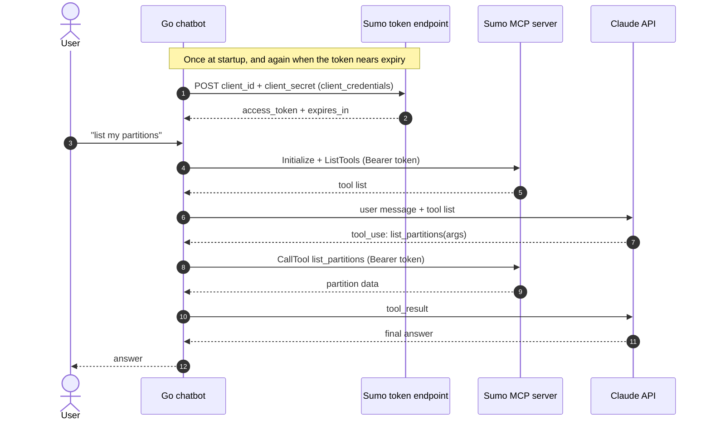

# Sumo Logic MCP Chatbot

A Go chatbot that answers questions about Sumo Logic (partitions, dashboards, alerts, logs) by calling the Sumo Logic MCP server. Claude decides which tool to call and writes the answer.

## Architecture



- **Client ID and secret:** used only at the token step.
- **Bearer token:** sent with every MCP request. It expires after 30 minutes.
- **Anthropic key:** sent with every Claude request.

## Configuration

Set these in your shell (for example in `~/.zshrc`):

| Variable | Value |
|---|---|
| `SUMO_TOKEN_URL` | `https://service.au.sumologic.com/oauth2/token` |
| `SUMO_CLIENT_ID` | OAuth client ID from Sumo |
| `SUMO_CLIENT_KEY` | OAuth client secret from Sumo |
| `SUMO_MCP_URL` | `https://mcp.au.sumologic.com/mcp` |
| `ANTHROPIC_API_KEY` | Claude API key (needed for the chat step) |

Don't use the Sumo Access ID and Access Key here. The MCP server rejects them. Create an OAuth client instead: **Administration > Account Security Settings > OAuth Clients**, with the Client Credentials type, a service account, and the scopes you need.

## Run

```bash
go mod tidy
go run .
```

Expected output: `token ok`, then the list of available tools.

## Status

- [x] OAuth token request
- [x] MCP connection and tool listing
- [ ] Token refresh before expiry
- [ ] Claude chat loop
- [ ] Exclude `x_amz_bedrock_agentcore_search` from the tools sent to Claude

## Security

- Never commit secrets. Keep them in shell env vars or a secrets manager.
- Start with read-only tools. Allow-list any write-capable tool explicitly.